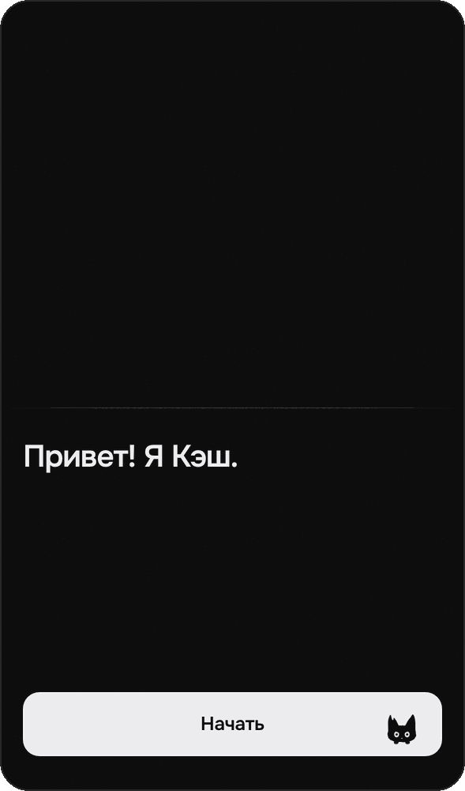
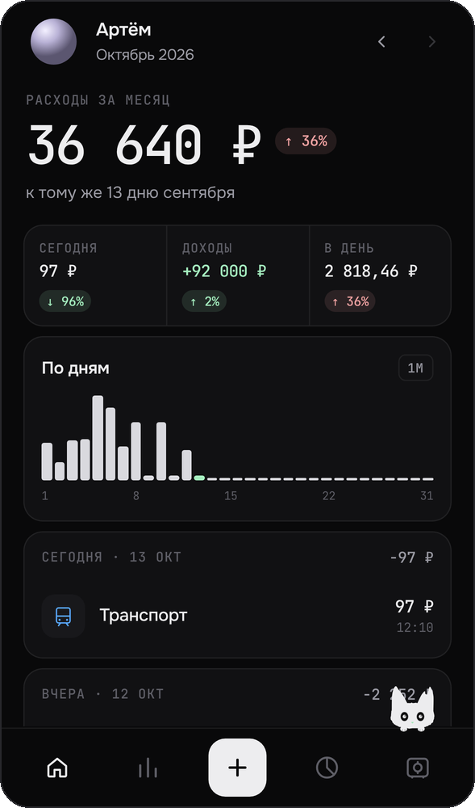
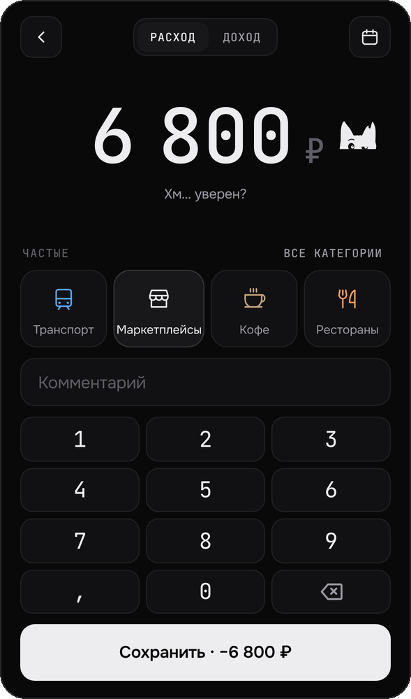
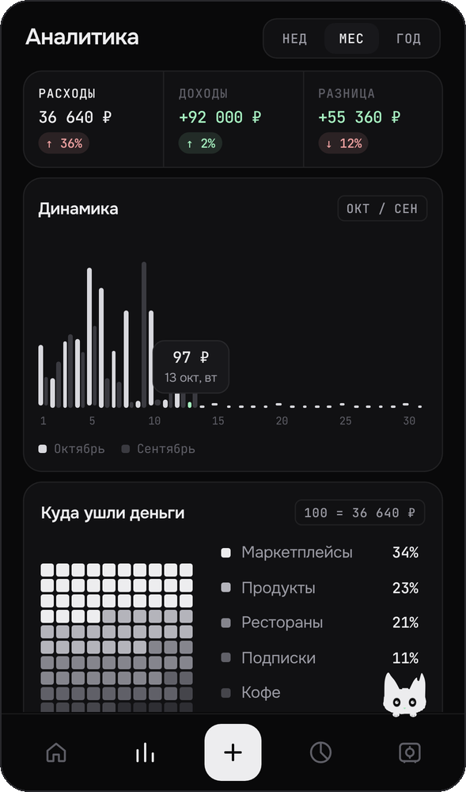
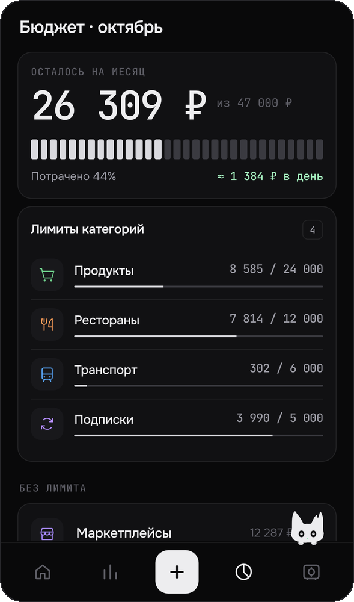
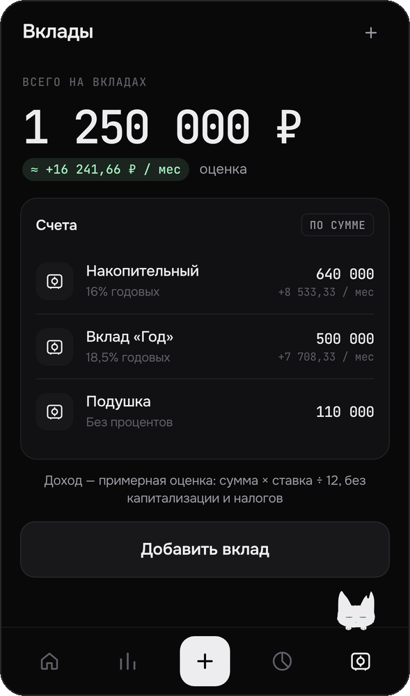
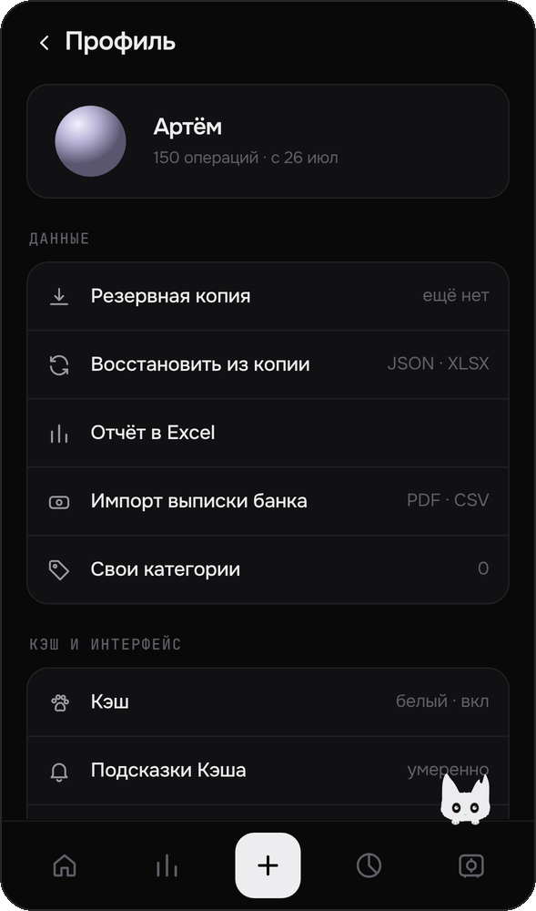

<p align="center">
  
</p>

<p align="center">
  <a href="https://qwekurasa.github.io/traty/"><b>Открыть приложение</b></a> ·
  <a href="#установка">Установка</a> ·
  <a href="#поддержать-проект">Поддержать</a> ·
  <a href="#english">English</a>
</p>

<p align="center">
  
  
  
</p>

**Кэш** — тёмный минималистичный трекер трат с котом-помощником. Без регистрации, без облака и без рекламы: все данные хранятся только в браузере на вашем телефоне.

## Возможности

- **Запись в одно касание.** Сумма, частая категория, сохранить. Расходы и доходы.
- **Аналитика.** Динамика к прошлому периоду, структура трат, тепловая карта за 13 недель, подсказки.
- **Бюджет.** Лимиты по категориям, остаток на день, предупреждения на 80 % и 100 %.
- **Вклады.** Суммы, ставки и примерный доход в месяц.
- **Импорт выписки Т-Банка** (PDF и CSV) без дублей: повторно загруженные операции не задваиваются.
- **Резервная копия и отчёт в Excel.** Восстановление из JSON или XLSX.
- **Кэш-маскот.** Сидит на краю таббара, реагирует на суммы и лимиты, даёт подсказки. Можно сделать тише, перекрасить или выключить.
- **Работает офлайн** и ставится на домашний экран как приложение.

## Скриншоты

| Знакомство | Главная | Ввод суммы | Аналитика |
|:-:|:-:|:-:|:-:|
|  |  |  |  |
| **Бюджет** | **Вклады** | **Профиль** | |
|  |  |  | |

## Приватность

- Нет аккаунтов, серверов, аналитики и трекеров.
- Операции лежат в IndexedDB вашего браузера, настройки — в localStorage.
- Выписка разбирается прямо на устройстве и никуда не отправляется.
- Строгая Content Security Policy: страница не может обращаться к сторонним адресам.

Данные привязаны к браузеру. Перед сменой телефона или очисткой браузера сохраните резервную копию: **Профиль → Резервная копия**.

## Установка

Откройте **[qwekurasa.github.io/traty](https://qwekurasa.github.io/traty/)**, затем:

- **iPhone (Safari):** «Поделиться» → «На экран „Домой“».
- **Android (Chrome):** меню ⋮ → «Установить приложение».
- **Компьютер (Chrome, Edge):** значок установки в адресной строке.

## Запуск у себя

Сборки нет — это статичные файлы.

```bash
git clone https://github.com/qwekurasa/traty.git
cd traty
python3 -m http.server 8080
# откройте http://localhost:8080
```

Чтобы развернуть свою копию, включите GitHub Pages для ветки `main` (Settings → Pages) или положите файлы на любой статический хостинг.

<details>
<summary>Устройство проекта</summary>

| Файл | Что внутри |
|---|---|
| `index.html` | Оболочка, CSP |
| `app.js` | Роутер, онбординг, ввод суммы и категории |
| `screens.js` | Главная, аналитика, бюджет, вклады, профиль, импорт |
| `ui.js` | Состояние, категории, иконки, диалоги |
| `kesh.js` | Маскот: позы, реакции, подсказки |
| `store.js` | IndexedDB |
| `statement.js` | Разбор выписки PDF/CSV |
| `backup.js`, `xlsx.js` | Резервная копия, чтение и запись XLSX без зависимостей |
| `sw.js` | Офлайн-кэш |

Чистый JavaScript (ES-модули), без фреймворков и сборщиков.
</details>

## Участие

Идеи и ошибки — в [Issues](https://github.com/qwekurasa/traty/issues). Pull request'ы приветствуются: держите код простым, без новых зависимостей, и проверьте изменения на телефоне.

## Поддержать проект

Кэш бесплатный и останется таким. Если он вам полезен:

- ⭐ поставьте звезду репозиторию — это помогает другим его найти;
- расскажите о нём друзьям;
- поддержите разработку донатом. <!-- DONATE_LINK -->

## Благодарности

- [PDF.js](https://github.com/mozilla/pdf.js) — Apache-2.0
- Шрифты [Onest](https://fonts.google.com/specimen/Onest) и [JetBrains Mono](https://github.com/JetBrains/JetBrainsMono) — SIL Open Font License 1.1
- Иконки категорий — [Phosphor Icons](https://phosphoricons.com), MIT

## Лицензия

[MIT](LICENSE) © 2026 qwekurasa

---

## English

**Kesh** is a dark, minimal expense tracker with a cat sidekick. No sign-up, no cloud, no ads: your data never leaves your phone's browser.

- One-tap entry for expenses and income, frequent categories
- Analytics: period-over-period trend, spending breakdown, 13-week heatmap
- Category budgets with 80 % / 100 % warnings
- Savings accounts with estimated monthly interest
- T-Bank statement import (PDF, CSV) with duplicate detection
- JSON backup and Excel export
- Works offline, installable as a PWA

**[Open the app →](https://qwekurasa.github.io/traty/)** The interface is currently in Russian; English is planned.

Run locally: `python3 -m http.server 8080` in the repo folder. No build step, no dependencies. Licensed under [MIT](LICENSE).
