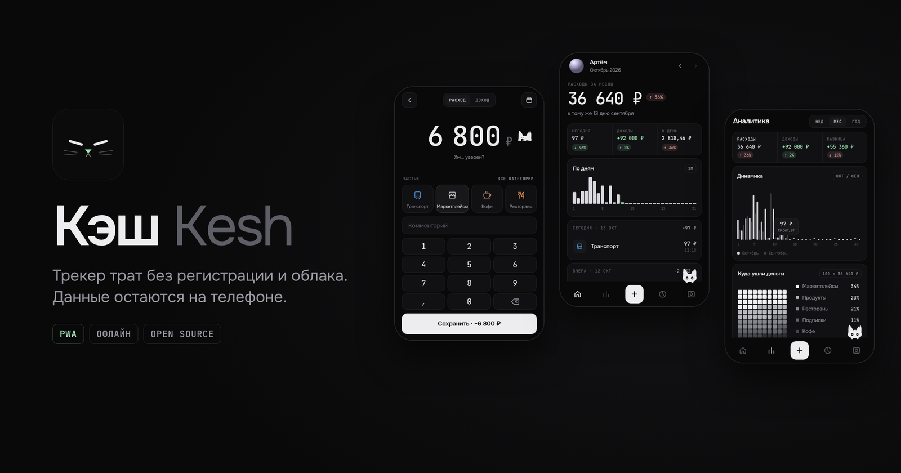

<p align="center"></p>

# Кэш

Трекер трат без регистрации и облака. Все данные хранятся только на телефоне.

**Приложение:** https://qwekurasa.github.io/kesh/

- Расходы и доходы, категории и комментарии
- Аналитика за любой период
- Кошелёк и лимиты по категориям
- Вклады и накопительные счета
- Импорт выписки Т-Банка (PDF, CSV)
- Резервная копия и отчёт в Excel
- Работает офлайн, русский и английский интерфейс

## Установка

Самый простой способ (iPhone и Android): открыть ссылку в браузере и добавить на главный экран.
iPhone: Safari → «Поделиться» → «На экран „Домой“». 
Android: Chrome → меню → «Установить приложение».

### Android-приложение

Скачать [Kesh.apk](https://github.com/qwekurasa/kesh/releases/download/apk/Kesh.apk), открыть на телефоне, разрешить установку.

### iPhone-приложение через Windows

1. Установить iTunes и iCloud с сайта Apple (не из Microsoft Store) и [Sideloadly](https://sideloadly.io/).
2. Скачать [Kesh.ipa](https://github.com/qwekurasa/kesh/releases/download/ipa/Kesh.ipa).
3. Подключить iPhone кабелем, нажать «Доверять».
4. В Sideloadly перетащить Kesh.ipa, ввести Apple ID, нажать Start.
5. На iPhone: Настройки → Основные → VPN и управление устройством → свой Apple ID → Доверять.
6. Настройки → Конфиденциальность и безопасность → Режим разработчика → включить, перезагрузить.

### iPhone-приложение через Mac

1. Установить Xcode из App Store.
2. Скачать репозиторий, открыть `ios/Kesh.xcodeproj`.
3. Signing & Capabilities → Team → свой Apple ID.
4. Подключить iPhone, выбрать его вверху, нажать ▶.
5. Доверие и режим разработчика — как в шагах 5–6 выше.

**Обновлять придётся:** с бесплатным Apple ID приложение работает 7 дней, затем его нужно установить заново тем же способом. Данные сохраняются. С платным аккаунтом разработчика — раз в год.

## Запуск у себя

```bash
git clone https://github.com/qwekurasa/kesh
cd kesh
python3 -m http.server 8080
```

Сборка не нужна. Папка `ios/` — проект Xcode для запуска на iPhone.

## Поддержать

Криптовалютой:

- Solana: `64kwY5adPeQVfzvsyvEpke5wsJuVEPXAY3bm6VuFBZf`
- Ethereum: `0xad4a06e063d0e83e783f9fb17efc6524a83a40f2`
- USDT TRC20: `TERWLLYABDAvMQTKPkpXwdKpU4AS5k8ff3`

## Лицензия

MIT. Сторонние компоненты: PDF.js (Apache-2.0), Air Datepicker (MIT), шрифты Onest, Outfit, JetBrains Mono (OFL), иконки Phosphor (MIT).
