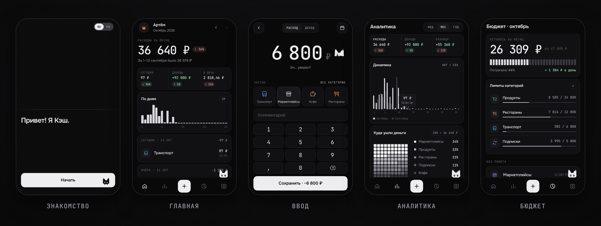

<p align="center"></p>

<p align="center">
  <a href="https://qwekurasa.github.io/kesh/"></a>
</p>
<p align="center">
  
  
  
  
</p>

<p align="center"></p>

|  |  |  |
|:--|:--|:--|
| ⚡ **Запись за 2 касания** | 📊 **Аналитика** · динамика, структура | 🎯 **Лимиты** · предупреждение на 80 % |
| 🏦 **Выписка Т-Банка** · PDF/CSV без дублей | 💾 **Копия и Excel** · JSON, XLSX | 🔒 **Только на телефоне** · без сервера |

**Установка:** откройте ссылку → «Поделиться» → «На экран „Домой“» (iPhone) или ⋮ → «Установить» (Android).

**Запуск у себя** — сборки нет:
```bash
git clone https://github.com/qwekurasa/kesh && cd kesh && python3 -m http.server 8080
```

**Поддержать:** ⭐ звезда · идея в [Issues](https://github.com/qwekurasa/kesh/issues) · донат <!-- DONATE_LINK -->

<sub>MIT © 2026 qwekurasa · [PDF.js](https://github.com/mozilla/pdf.js) (Apache-2.0) · шрифты Onest, Outfit, JetBrains Mono ([OFL](fonts/LICENSE.txt)) · иконки [Phosphor](https://phosphoricons.com) (MIT)</sub>

---

<sub>🇬🇧 **Kesh** — an expense tracker with a cat. No account, no cloud, works offline. [Open the app](https://qwekurasa.github.io/kesh/) and switch to English on the first screen. Run locally with the command above.</sub>
